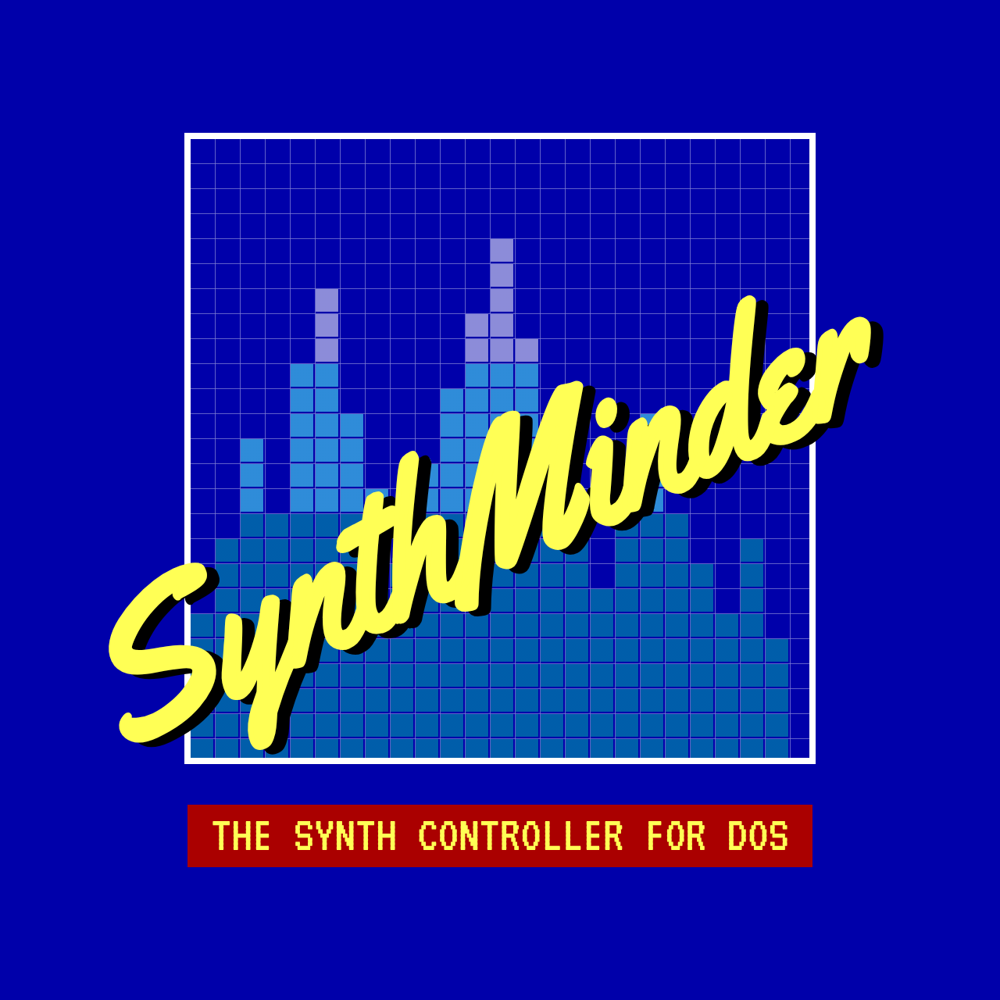
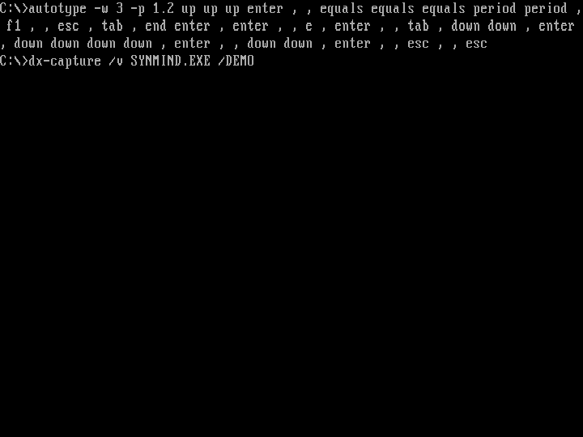

<p align="center">
  
</p>

# SynthMinder

[](https://github.com/MaverickUK/SynthMinder/actions/workflows/ci.yml)
[](https://github.com/MaverickUK/SynthMinder/tags)

## See and change your HDD Synth, IDE Synth Bay and FDD Synth Duo from DOS

SynthMinder runs on the DOS PC an [IDE Synth Bay](https://github.com/MaverickUK/HDDSynthPro) is fitted to. It shows how the Bay and the [HDD Synth](https://github.com/MaverickUK/HDDSynth_Native) behind it are set up (the synth's sample packs, volume and balance, the Bay's disk and CD-ROM images), and changes what can be changed: the synth's pack, volume and balance, the CD in the Bay's CD-ROM drive, and the Bay's hard disk for the next power-on. With an [FDD Synth Duo](https://github.com/MaverickUK/FDDSynthPro) on the floppy cable, it also changes the disk in each of its drives, its sample pack and its volume.

It's [GameMinder](https://github.com/MaverickUK/GameMinder)'s sibling: the same PathMinder-style screen and colours.

[](docs/synthminder-demo.mp4)

*SynthMinder in DOSBox-X, against its pretend Bay, synth and Duo (`SYNMIND /DEMO`): on the Sound tab, playing another of the HDD Synth's packs, turning its volume up and its balance right, help, then playing the Duo's other pack; the Floppy tab (`MONKEY1.IMG` put in the Duo's B:); the CD-ROM tab (`QUAKE.ISO` put in the drive and taken out again); then the Settings tab: seek timing set to a 2005 drive's from the next power-on, and write-behind's question, left as it was. [Watch as MP4](docs/synthminder-demo.mp4). Recorded by `scripts/record-demo.sh`.*

**Status: in development.** It runs against IDE Synth Bay firmware from its `synthminder` branch (0.36.0-dev) and the HDD Synth from its `synthminder-link` branch (0.25.0), and against a pretend Bay and synth (`SYNMIND /DEMO`). What's next: [ROADMAP.md](ROADMAP.md).

## How it works

SynthMinder finds the Bay on the PC's IDE bus and talks to it through a command of its own. The Bay answers for itself, and passes the synth's part on over the Synth Link, the wire between the two. The messages are the same ones the HDD Synth's USB companion app uses. Details: [docs/protocol.md](docs/protocol.md).

The FDD Synth Duo can't take a command: the floppy cable carries only pulses and levels. So SynthMinder writes its request to a sector at cylinder 82, past the end of an 80-track disk, and reads the Duo's reply from the same track, through the BIOS. The Duo serves that cylinder itself and never touches the disk's image. An exchange takes about half a second. Details: FDDSynthPro's [docs/synthminder.md](https://github.com/MaverickUK/FDDSynthPro/blob/synthminder-mailbox/docs/synthminder.md).

It needs plain DOS: under Windows, Windows' own disk driver owns the IDE ports. Boot to the command prompt first.

## Using it

```
SYNMIND           find the Bay and open SynthMinder
SYNMIND /DEMO     try it with a pretend Bay and synth
SYNMIND /STATUS   print what the Bay and synth say, and exit
SYNMIND /V        print the version
```

And for batch files, run in the order given, with no screen:

```
SYNMIND /DISC=QUAKE.ISO      put a CD image in the Bay's CD-ROM drive (/DISC=- takes it out)
SYNMIND /PACK=3              play a sample pack, by number, folder or name (/PACK=fdb05)
SYNMIND /VOL=60 /BAL=50      the synth's volume and balance, 0-100
SYNMIND /FDA=GAMES.IMG       a disk image into the FDD Synth Duo's A: (/FDB= into its B:)
SYNMIND /FDEJECT=A           take the disk out of the Duo's A: (or B)
SYNMIND /FDPACK=2 /FDVOL=60  the Duo's sample pack (number or name) and volume
SYNMIND /Q ...               no messages, just the ERRORLEVEL
```

The ERRORLEVEL: 0 done, 1 a bad option, 2 no Bay found (or it didn't answer), 3 refused (no such image or pack, no CD-ROM drive set up), 4 no HDD Synth on the Synth Link, 5 no FDD Synth Duo. `/FDA=` waits until the disk is in, so a batch file can use the drive straight after: `SYNMIND /FDA=MONKEY1.IMG /Q`, then `A:`. A game's batch file can start with `SYNMIND /DISC=QUAKE.ISO /Q`, so the right CD is in the drive before the game asks for it.

| Key | |
|---|---|
| Left, Right | the tabs, one for each thing that changes: **Sound**, **Floppy**, **Hard disk**, **CD-ROM**, **Settings**; then Exit |
| Tab | the next tab |
| Up, Down, PgUp, PgDn, Home, End | the list |
| Enter | use the highlighted one. Sound: play the pack. Floppy: put the disk in a drive. Hard disk: make it the hard disk from the PC's next reset. CD-ROM: put the disc in the drive. Settings: change the setting, from the next power-on |
| `A` `B` | Floppy: put the disk in the Duo's A: or B: |
| `E` | Floppy, CD-ROM: take the disk or disc out |
| `+` `-` | Sound: the volume of the synth whose pack is highlighted |
| `<` `>` | Sound: the HDD Synth's balance |
| `R` | ask again (and look for the Duo, if it hasn't been found) |
| F1 | help |
| Esc | exit |

## More

- [Design](docs/design.md): the screen, and what changes when
- [Protocol](docs/protocol.md): SynthMinder, the Bay and the synth
- [Building and testing](BUILD.md)
- [Roadmap](ROADMAP.md) and [changelog](CHANGELOG.md)

SynthMinder follows [Semantic Versioning](https://semver.org). GPL-3.0, as GameMinder.

---

<p align="center">
  
</p>
